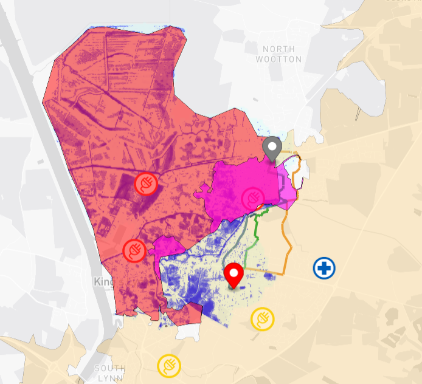

# Kings Lynn Flood Routing Digital Twin Visualisation Framework (TWA-VF)

This visualisation serves as a proof of concept, leveraging knowledge graph technology for:

1) Flood routing for vehicles with various water depth wading capabilities.
2) Isochrone mapping from points of interest, highlighting unreachable area and affected population.
3) Travelling Salesman Problem for fastest route to restore flooded power stations.
4) Road network sensitivity analysis before and after flood, so the roads most needed for restoration can be identified.

This visualisation uses result of

1) [IsochroneAgent](https://github.com/cambridge-cares/TheWorldAvatar/tree/main/Agents/IsochroneAgent)
2) [TravellingSalesmanAgent](https://github.com/cambridge-cares/TheWorldAvatar/tree/main/Agents/TravellingSalesmanAgent)
3) [NetworkAnalysisAgent](https://github.com/cambridge-cares/TheWorldAvatar/tree/main/Agents/NetworkAnalysisAgent)

The instantiated data is visualised using the TWA Visualisation Framework [TWA-VF](../twa-vis-framework) version `4`.

## Deployment

1. Create and/or copy files according to instructions stated in [Stack manager input](#stack-manager-input) and [Stack data uploader input](#stack-data-uploader-input).
2. Modify environment variables in `.env` file if needed (default values are already in the file):
   - `PORT_NUMBER`: the port number that the stack is exported to, needed for local communication with agents.
   - `PUBLIC_URL`: the URL users use to access the visualisation. No / at the end.
   - `STACK_NAME`: the name of the stack.

3. Execute `deploy.sh` in commandline, which calls the following three scripts:

- `update_input_config.sh`: updates configuration files of the stack and agents. Be aware that this will replace the current configuration files.
- `restart_stack.sh`: restarts the stack and upload data. Be aware that this will remove any existing stack with the same name.
- `call_agent.sh`: trigger agents to act on uploaded data.

## Accessing the visualisation

Visualisation can be seen at [http://localhost:3838/visualisation](http://localhost:3838/visualisation) when deployed locally.

## Stack manager input

Create the following files in `stack-manager\inputs\secrets`:

- `postgis_password`: Password for accessing postgres database. User name is `postgres` by default.
- `geoserver_password`: Password for accessing geoserver control panel. User name is `admin` by default.
- `mapbox_username`: User name for using the Mapbox visualiastion backend.
- `mapbox_api_key`: API key for using the Mapbox visualiastion backend.

For more information, please check [here](https://github.com/TheWorldAvatar/stack/blob/main/stack-manager/README.md).

## Stack data uploader input

Use the stack-data-uploader to upload the routing data `routing`, Raster data `flood`, `elevation`, `population`, and grid primary site data `grid_primary_site`.

Processing scripts applied to various datasets are in the `sql` folder. `icons` contain static images used for visualisation.

For more information, please check [here](https://github.com/TheWorldAvatar/stack/blob/main/stack-data-uploader/README.md).

### Elevation

Path: `stack-data-uploader\inputs\data\kingslynn\elevation\`

Detailed elevation `.tif` file can be retrieved from CARES. Otherwise, it can be downloaded from [USGS EROS Archive - Digital Elevation](https://www.usgs.gov/centers/eros/science/usgs-eros-archive-digital-elevation-shuttle-radar-topography-mission-srtm-1#overview).

### Grid Primary Site

Path: `stack-data-uploader\inputs\data\kingslynn\grid_primary_site\`

Downloaded from [ukpowernetworks](https://ukpowernetworks.opendatasoft.com/explore/dataset/grid-and-primary-sites/information/?disjunctive.sitename&disjunctive.powertransformercount&disjunctive.local_authority&location=14,52.76712,0.42611&basemap=jawg.light). `.csv` file.

### Flood Data

Path: `stack-data-uploader\inputs\data\kingslynn\flood\`

Fathom flood data held at CMCL in `.tif` format.

_Flood data is proprietary and provided under creative commons license._

### Population

Path: `stack-data-uploader\inputs\data\kingslynn\population\`

Population Raster data is retrieved from [OpenPopGrid](http://openpopgrid.geodata.soton.ac.uk/) in `.tif` format.

Note: Currently, QGIS is used to consume the .asc file, crops desired location and exported in tif file.

### Routing

Path: `stack-data-uploader\inputs\data\kingslynn\routing\`

1) [BBBike.org](https://extract.bbbike.org/) allows you to extract selected region. A file of around 3.5mb in the area around King's Lynn was found optimal.
2) [Geofabrik](https://download.geofabrik.de/) allows you to download OSM data via region/country

`.osm` or `pbf` file, the latter preferred.

Note:
Downloading cropped map from BBBike.org is currently the best option. If OSM map data is downloaded from Geofabrik and subsequently cropped by using tool such as osmium or osmium will result in leaving out certain nodes, subsequently when imported via osm2pgrouting will lead to invisible/non-existent road.